# EKS Spot + Karpenter: bake-off với Cluster Autoscaler và EKS Auto Mode

Bài nói 15 phút và demo nhỏ về FinOps trên EKS. Trọng tâm là **Karpenter**: chạy Spot, tự chọn máy vừa đủ, gom node (consolidation) và xử lý cảnh báo thu hồi. **Cluster Autoscaler** và **EKS Auto Mode** là hai mốc so sánh; **OpenCost** là công cụ đo chi phí.

> Dự án học tập và demo cá nhân của Nguyễn Đức Toàn. Quan điểm là của cá nhân tác giả.

**Trạng thái:** đã lint và test offline (terraform, helm, script, deck). Đã có một phép đo thật Auto Mode vs Karpenter (xem phần "Kết quả đo thật"). Bộ Terraform và demo đầy đủ (Cluster Autoscaler, OpenCost, chaos) chưa chạy trên cluster thật, và deck vẫn còn placeholder (`Đo: ___`).

**Tốn tiền:** cluster demo khoảng $0.375/giờ (~$9/ngày) kể cả khi rảnh (ước tính theo giá list). Chạy xong phải chạy `scripts/06-down.sh`. Xem [docs/runbook.md](docs/runbook.md).

## Karpenter trong demo

Một NodePool ưu tiên Spot, có On-Demand dự phòng, đa dạng loại máy, và consolidation:

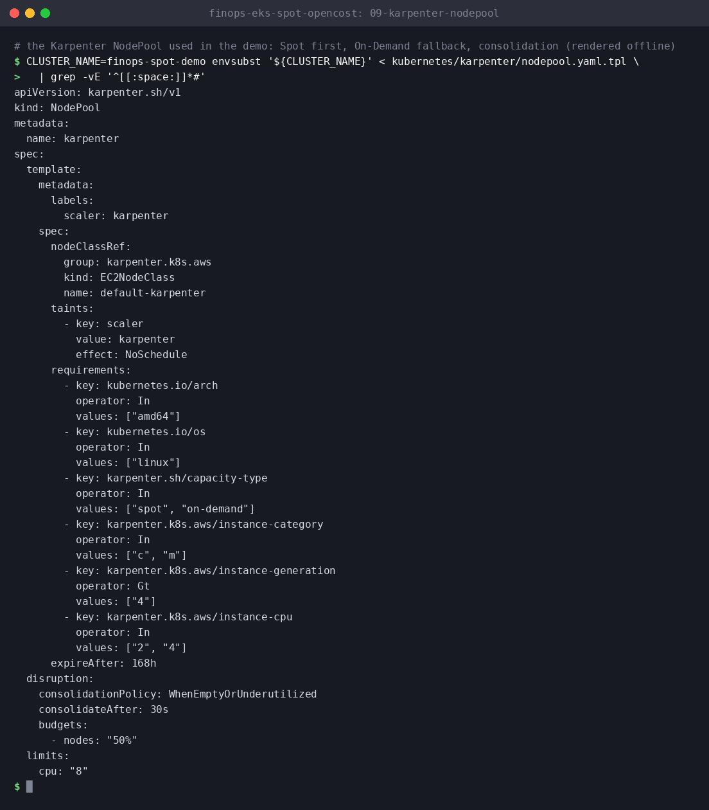

| | Cluster Autoscaler | **Karpenter** | EKS Auto Mode |
|---|---|---|---|
| Cách thêm node | Tăng Auto Scaling Group có loại máy cố định | Chọn loại máy theo Pod Pending, gọi EC2 Fleet | Karpenter do AWS vận hành |
| Spot bị thu hồi | Capacity Rebalancing của node group | Nghe cảnh báo qua SQS, drain, chọn máy khác | AWS xử lý |
| Gom node | Scale-down theo ngưỡng | `WhenEmptyOrUnderutilized` | Có |
| Vận hành | Tự quản node group, AMI | Tự cài Helm + IAM + SQS | AWS quản lý, thêm phí ~12% giá On-Demand |

Bảng chỉ nêu khác biệt kiến trúc. Ai nhanh hơn, rẻ hơn thì chỉ kết luận sau khi có số đo (xem [docs/decisions.md](docs/decisions.md)).

## Cấu trúc

| Đường dẫn | Nội dung |
|---|---|
| `terraform/` | VPC, EKS, IAM cho Karpenter / Cluster Autoscaler / Auto Mode, `tests/` |
| `kubernetes/` | `karpenter/`, `cluster-autoscaler/`, `automode/`, `opencost/`, `boutique/` (Helm chart), `benchmark/` |
| `scripts/` | `01-up.sh` ... `06-down.sh`, `fill_results.py`, `lint.sh`, `tests/` |
| `results/` | schema, template CSV, `summary.json`, `RESULTS.md`, bảng giá list |
| `docs/` | [architecture](docs/architecture.md), [decisions](docs/decisions.md), [runbook](docs/runbook.md), [verification](docs/verification.md), `img/` |
| `presentation/` | deck 14 slide, `script.md` (kịch bản và speaker notes), build và verify |

## Dùng nhanh

```bash
make help          # danh sách lệnh, tất cả chạy offline
make lint test validate
make deck deck-verify
```

Chạy demo thật (tạo tài nguyên AWS tính phí) chỉ làm theo [docs/runbook.md](docs/runbook.md). Các script chỉ chấp nhận cluster `finops-spot-demo*`, bắt buộc `CLUSTER_NAME` và `EXPECTED_AWS_ACCOUNT_ID`, và `01`/`06` đòi gõ xác nhận từ terminal.

## Kết quả đo thật: EKS Auto Mode vs Karpenter tự quản lý

Đo trên một cluster EKS 1.36 thật (us-west-2), Karpenter 1.13.1, **On-Demand** (chưa đo Spot), image `pause`, mỗi ô lặp 3 lần xen kẽ thứ tự. Thời gian lấy từ API server (độ phân giải 1 s), mốc 0 là lúc Pod đầu tiên được tạo. Chi phí là ước tính theo giá list, chưa gồm phí quản lý của Auto Mode. Số liệu gốc: [results/live/runs.csv](results/live/runs.csv), tổng hợp: [results/live/SUMMARY.md](results/live/SUMMARY.md). Mỗi ô là trung vị (min đến max).

| Replica | Chỉ số | Auto Mode | Karpenter |
|---|---|---|---|
| 5 | Node đầu tiên Ready (s) | 16 (16-18) | 25 (24-26) |
| 5 | Tất cả Pod Ready (s) | 21 (20-23) | 27 (26-28) |
| 15 | Node đầu tiên Ready (s) | 16 (15-17) | 24 (23-24) |
| 15 | Tất cả Pod Ready (s) | 28 (23-29) | 28 (27-28) |
| 30 | Node đầu tiên Ready (s) | 16 (15-20) | 24 (23-25) |
| 30 | Tất cả Pod Ready (s) | 33 (32-40) | 41 (39-42) |
| 5 / 15 / 30 | Giá ước tính ($/giờ) | 0.153 / 0.153 / 0.306 | 0.153 / 0.153 / 0.306 |

**Đọc kết quả thẳng thắn:** Karpenter không nhanh hơn Auto Mode trong thí nghiệm này. Auto Mode có node Ready sớm hơn khoảng 8 đến 9 giây, hòa ở 15 replica, nhanh hơn ở 5 và 30 replica. Chi phí gần như bằng nhau vì cả hai đều ra 2 node (ràng buộc rải đều 2 AZ), nên thí nghiệm này chưa phân biệt được khả năng chọn máy vừa đủ. Lượt nguội đầu tiên của Auto Mode chậm (55 s), n=3 là ít. Giới hạn: 1 cluster, 1 region, không Spot, Pod chỉ xin 200m CPU và 256Mi, và hai bên chạy chung một cluster.

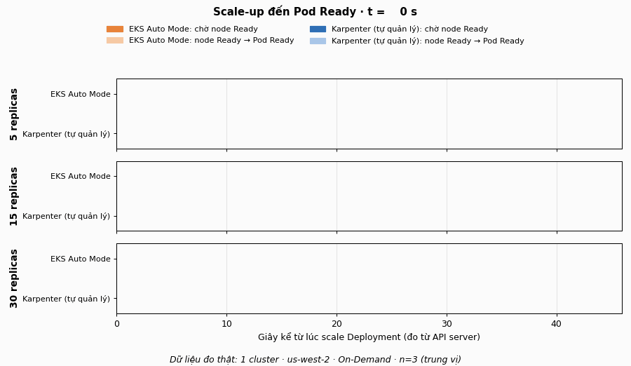

| Auto Mode (15 replica) | Karpenter (15 replica) |
|---|---|
| 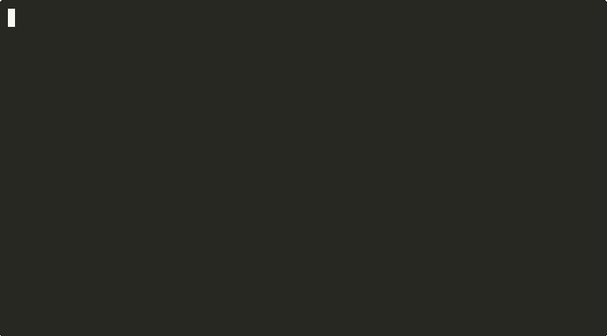 |  |

Hai GIF terminal quay từ một lượt chạy thật, đo bằng polling phía client (sai số khoảng 2 giây), khác với bảng đo từ API server ở trên. Harness đo: [scripts/live-bench.sh](scripts/live-bench.sh), manifest: [kubernetes/live-bench/](kubernetes/live-bench/). Chạy lại cần cluster EKS Auto Mode của riêng bạn, đặt `BENCH_CLUSTER` và `BENCH_REGION`; script tự lấy account id từ `aws sts get-caller-identity` và từ chối chạy nếu context kubectl không khớp.

## Kiểm tra offline (ảnh chụp từ lệnh thật)

Không có lệnh nào chạm AWS hay cluster. Chưa có ảnh nào từ cluster thật.

| Lệnh | Ảnh |
|---|---|
| Guard từ chối thiếu biến, tên cluster lạ, account id sai | 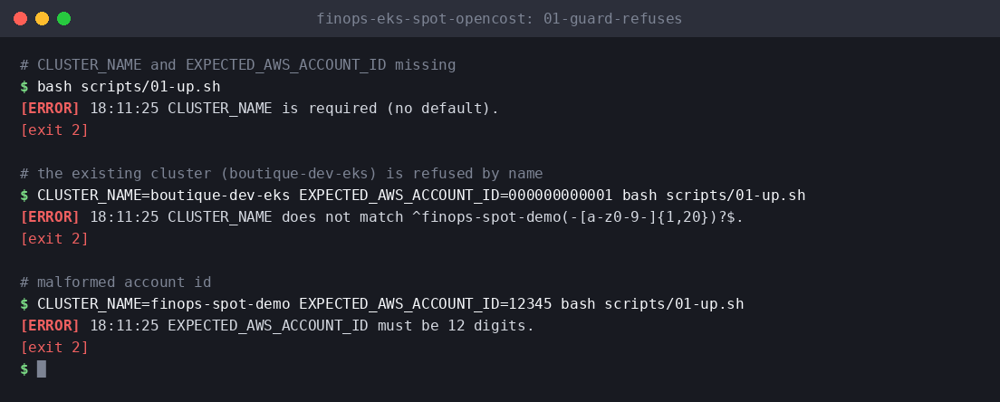 |
| Cảnh báo chi phí và gõ xác nhận (`aws`, `terraform` là stub của sandbox test) | 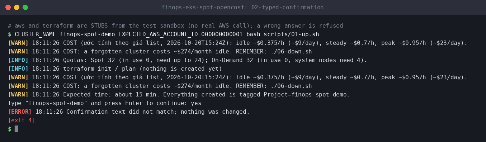 |
| `terraform test`: 24 test validation biến | 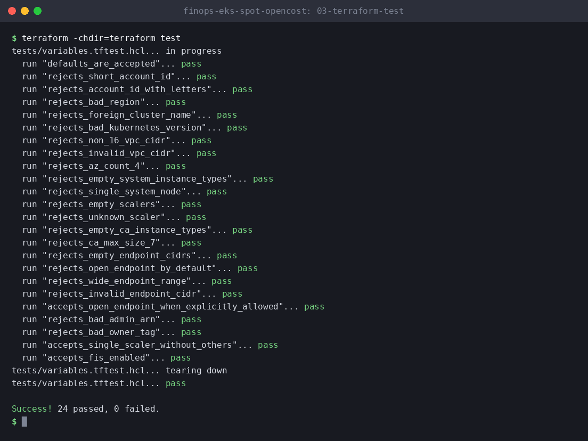 |
| `terraform fmt` và `validate` | 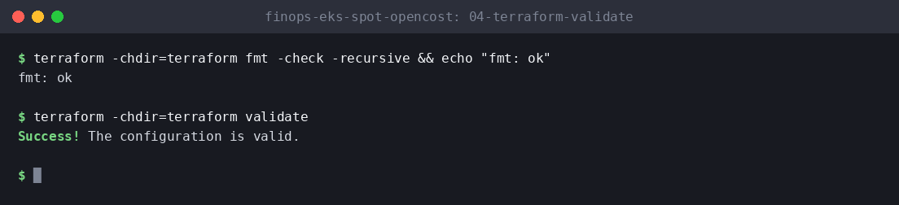 |
| `helm template` cho từng scaler (10 Deployment, 3 PDB, nodeSelector riêng) | 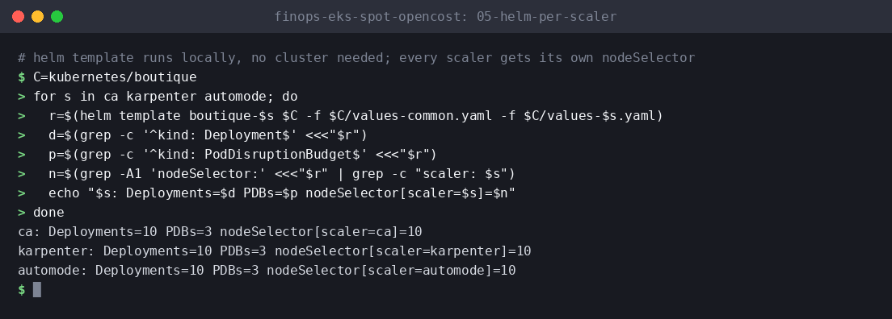 |
| Test guard bằng stub (100 assertion, lược phần giữa) | 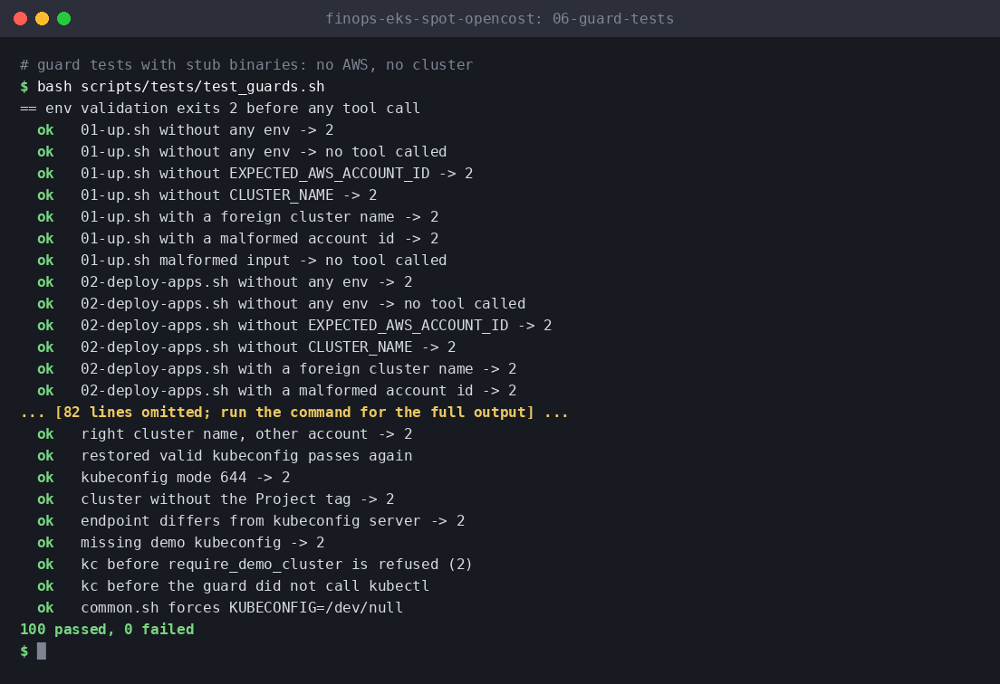 |
| `fill_results.py` trên dữ liệu mẫu SYNTHETIC, **không phải số đo** | 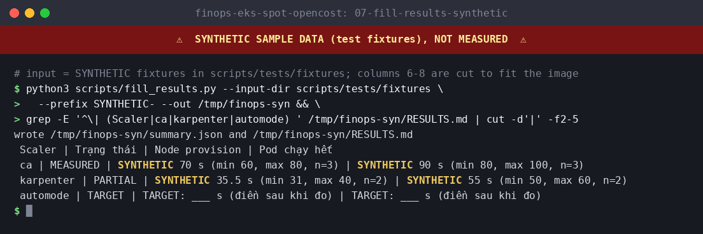 |
| `verify_deck.py` | 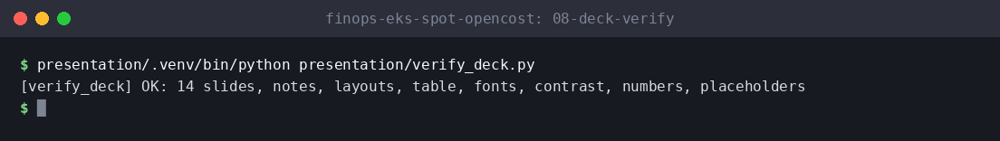 |

Tạo lại ảnh: `make screenshots`.

**Còn thiếu (placeholder, chụp sau buổi demo thật):** node Karpenter xuất hiện lúc scale-up, chi phí theo namespace trên OpenCost UI, phục hồi khi mất node. Lệnh chụp nằm trong [docs/runbook.md](docs/runbook.md); che account id trước khi đưa ảnh vào repo.

## Giấy phép

Mã và tài liệu: [MIT](LICENSE). Thành phần bên thứ ba và template slide AWS FCJ (không thuộc MIT): xem [NOTICE.md](NOTICE.md). Đóng góp: [CONTRIBUTING.md](CONTRIBUTING.md). Bảo mật: [SECURITY.md](SECURITY.md).
