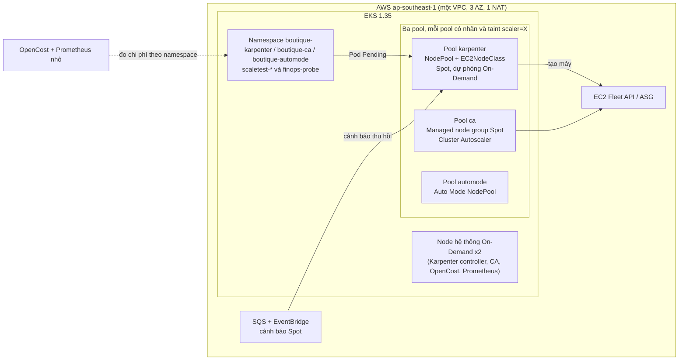

# Kiến trúc

Một cluster EKS, ba node pool cô lập. Karpenter là pool chính; Cluster Autoscaler và EKS Auto Mode chạy cùng điều kiện để so sánh.

## Luồng Karpenter

1. Pod `Pending` có `nodeSelector` và toleration `scaler=karpenter`.
2. Karpenter đọc `NodePool` (Spot trước, On-Demand dự phòng, họ máy `c`/`m` thế hệ > 4, 2 hoặc 4 vCPU, giới hạn 8 vCPU) và `EC2NodeClass` (subnet và security group theo tag `karpenter.sh/discovery`).
3. Karpenter gọi EC2 Fleet API, node join cluster, Pod được xếp lên.
4. Khi Spot sắp bị thu hồi, EventBridge gửi vào SQS; Karpenter cordon, drain và thay node.
5. Consolidation (`WhenEmptyOrUnderutilized`, 30 giây) gom node thừa.

## Đo lường

`scripts/03` đo thời gian scale-up bằng workload `inflate` (pod `pause`), `scripts/05` xoá một node để đo phục hồi (probe HTTP liên tục), `scripts/04` xuất chi phí từ OpenCost cộng một mô hình giá list độc lập. `scripts/fill_results.py` gộp CSV thành `results/summary.json`; deck chỉ đọc file này.

Sơ đồ mô tả thiết kế; cluster chưa được dựng thật.
